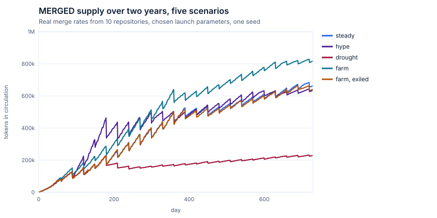
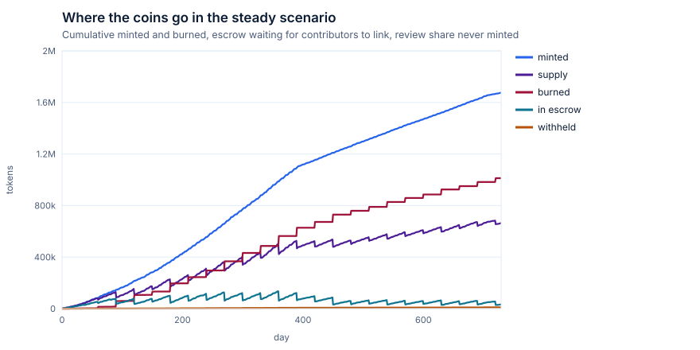
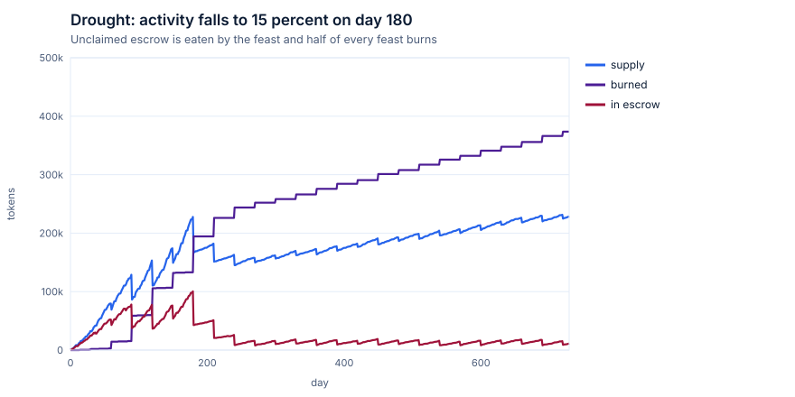
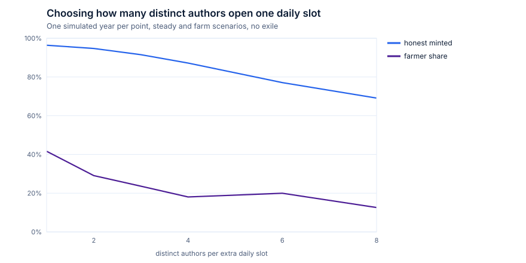
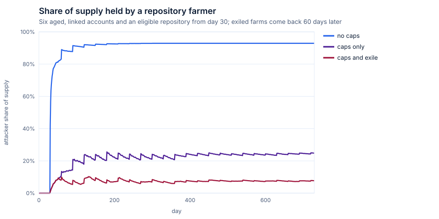

# Mergoshi: design

Mergoshi is an NEP-141 memecoin on NEAR whose supply grows only when real work lands: a pull request merged into a participating open source repository. Every rule lives in the token contract. There is no owner, no admin method and no backend that can mint; a small bonded set of attesters can only report what GitHub shows, and they are paid when they agree and slashed when they do not.

Track: **Memecoins With Mechanics**. The brief asks for a meme that does something, with the mechanic in the contract, parameters fixed at launch, plain sybil limits, a page with live state and a mint and burn log, and a simulation before choosing parameters. Mergoshi was designed against that list item by item. It also touches the social track (programmable rewards, contributor reputation), but its centre is supply mechanics, so it is entered in memecoins only.

## 1. The mechanic in one paragraph

When a pull request is merged into an enrolled repository, three attesters each read it from the public GitHub API, write the same canonical claim, and commit to its hash. After the commit window they reveal. The moment two of them reveal the same claim, the contract mints 100 MRGO (halving every 10 000 merges) and splits it: 70 to the author, 20 shared by up to three approving reviewers (the **LGTM tax**), 5 to the two attesters that settled it, 5 to the **feast pot**. A merge nobody approved never mints its review share. Authors who merge in consecutive weeks earn a **streak** bonus of 10 percent per week, up to 40 percent. Contributors who have not linked a NEAR account have their coins held in **escrow**; if they do not link within 60 days of their first unclaimed coin, the escrow is burned. Every 30 days anyone can call the **maintainers' feast**: half the pot is burned and half is served to the period's most active reviewers. Holders can **exile** a repository that farms coins by burning as much as it minted over the last two windows.

## 2. Why this is a meme that does something

| Rule | What the community feels |
|---|---|
| Mint only on merge | The coin is a receipt for shipped work. No merge, no coin. |
| LGTM tax | Approving a pull request literally pays. Self-merges earn 20 percent less. |
| Streaks | Ship every week to grow your multiplier; miss a week and it resets. |
| Escrow with a 60-day fuse | Your merged PRs already earned coins. Link your GitHub before they burn. |
| Maintainers' feast | Monthly ritual: half the pot burns, half feeds the reviewers who kept the lights on. |
| Repo offering | Bringing a new repository in costs a 500 MRGO burn, kept whether or not it qualifies. |
| Exile | Holders can banish a farm, but only by burning as much as it took. |

## 3. Proving a merge on chain

A NEAR contract cannot call GitHub, and a GitHub webhook is signed with a repository secret that the contract cannot check. Mergoshi therefore uses a small, fixed, bonded oracle set with commit and reveal.

**Claims.** Every fact is a canonical text claim: fields joined by a newline, no trailing newline, lower case repository names, unix seconds, numeric GitHub ids (stable across renames). Two attesters can only agree if they wrote byte-identical text. The contract parses and refuses anything non-canonical.

```
merge \n owner/repo \n number \n merge sha \n merged_at \n author id \n author login \n author created_at \n id:login,id:login (approvers, sorted by id)
link  \n github id  \n login  \n near account \n github created_at
repo  \n owner/repo \n repo id \n enough stars 0|1 \n created_at \n fork 0|1
```

Attester policy, part of the claim specification: pull requests by bot accounts are not attested; approvers are reviewers whose latest review submitted at or before the merge is an approval and who are trusted in the repository. GitHub reports that trust as `author_association`. `OWNER`, `MEMBER` and `COLLABORATOR` always count. `CONTRIBUTOR` only means the account has had a commit merged, and GitHub also shows maintainers whose organization membership is private this way, so a `CONTRIBUTOR` approval counts when the reviewer merged the pull request themselves (merging needs write access) or had at least 3 of their own pull requests merged into the repository before this merge (one search call). `FIRST_TIME_CONTRIBUTOR`, `FIRST_TIMER`, `NONE` and `MANNEQUIN` never count, so a drive-by account cannot approve its way into the review share. Every input is fixed once the pull request is merged, so attesters reading at different times agree; the repository claim carries a 0 or 1 for "has at least `min_repo_stars` stars" rather than the live count, so two attesters reading a few seconds apart still agree.

**Rounds.** One round per key (`merge:owner/repo#123`, `link:<id>:<account>`, `repo:owner/repo`). The first commit opens it.

1. Commit: `sha256(attester || "\n" || key || "\n" || sha256(claim) || salt)`. Binding the attester id stops copying another attester's commitment.
2. Reveal: allowed when the commit window ends, or at once if every active attester has committed. A reveal of `null` means "this did not happen".
3. Settle: the first claim hash revealed by a quorum (a strict majority, checked at launch) settles the round and its effect runs in the same transaction. If a quorum reveals `null`, the round is rejected and the key stays open, so a griefer cannot block a pull request that is merged later.
4. Slash: anyone whose reveal disagrees with the settled hash loses 20 percent of their bond, paid to the attesters who settled it. A slashed attester below the bond is inactive until it tops up.
5. Sweep: anyone can close finished rounds. Rounds that never reach quorum expire with no slash.

Commit and reveal also stops lazy attesters from waiting for one honest attester and echoing it: they must read GitHub themselves or reveal blind.

**What attesters may open.** A merge round only for an enrolled repository, a link round only for an on-chain link request, a repo round only for an on-chain proposal. The contract never accepts an arbitrary key.

**Linking a GitHub account.** The NEAR account calls `request_link(github_id, login)` with a small storage deposit. The contributor publishes a public gist containing `mergoshi-link:<near account>`. Attesters check the gist and the account age and attest the link claim. Both sides consented: the NEAR account by signing, the GitHub account by publishing.

## 4. Threat model for minting

Security assumption: **fewer than a quorum of attesters collude**. Liveness assumption: **at least a quorum of attesters is online**. Both are stated, not hidden.

| Threat | What stops it | Limit |
|---|---|---|
| One attester invents a merge | Needs a quorum; honest attesters reveal `null`, the round is rejected and the liar slashed | A colluding quorum can mint. Mitigation is the bond, an attester set run by different people, and a public log anyone can audit against GitHub |
| Attester copies others | Commitments are bound to the attester id and hidden until reveal | An attester can still skip work and stay silent; it then earns nothing |
| Back-minting history | Merges older than `max_merge_age_secs` (7 days) mint nothing; a new repository cannot mint merges from before it joined | Genesis repositories get a 7-day lookback at launch |
| Double mint of one merge | Settled keys are recorded and refused | none |
| Bots | Attesters skip `[bot]` and `Bot` accounts | A bot running on a human account looks human |
| Throwaway GitHub accounts | Authors younger than 90 days mint nothing and do not count toward diversity; links need 90 days too | Aged accounts can be bought |
| Repository farming | Diversity cap: a repository mints at most 1 + (distinct aged authors this or last 30-day window) / 3 merges a day, never more than 12; each author at most 4 a day; new repositories need 100 stars, 180 days and a 500 MRGO burn; holders can exile a farm | **An attacker who controls an eligible repository and several aged accounts can farm up to its cap until someone exiles it.** The simulation measures this: about 25 percent of supply after two years if nobody reacts, about 8 percent if holders exile each farm three weeks after it starts |
| Self-approval rings | The author is never an approver; unreviewed merges mint 20 percent less | Puppets can approve each other; the diversity cap and exile bound the damage |
| Attester commits and never reveals | No reward; every miss is counted on chain (`missed`) and shown on the dashboard | No automatic removal, since the set is fixed |
| Payout to an account that cannot hold tokens | Link requests register the account and block unregistering while pending; linked accounts and attesters can never unregister; any payout to an unregistered account falls back to escrow, so a reveal batch never panics | none |
| Storage spam | Link requests and proposals carry a deposit; exile burns must be at least a tenth of the minimum; dust unregister burns are counted but not logged; transfers to the contract itself are refused; the feast guest list is capped at 400 per period so the feast always fits in one call | |
| Exile griefing | Exiling costs as much as the repository minted over two windows, at least 1 000 MRGO, burned | A rich holder can exile a small honest repository. Cost scales with the repository's own output |

Out of scope, by design: changing any parameter, removing an attester, delisting a repository other than by exile, or recovering coins. There is no admin key to do any of it.

## 5. Parameters and why

All parameters are set in `new(params)` and readable with `params()`. Values for the hackathon testnet deployment differ only where a demo needs minutes instead of days; both sets are fixed at their launch.

| Parameter | Production | Testnet demo | Why |
|---|---|---|---|
| attesters, quorum | 5, 3 | 3, 2 | strict majority enforced at launch |
| bond | 50 NEAR | 0.2 NEAR | testnet budget |
| commit, reveal window | 10 min, 20 min | 30 s, 60 s | demo speed |
| slash | 20 percent of bond | same | painful but survivable for an honest bug |
| base reward, halving | 100 MRGO, every 10 000 merges | same | asymptotic cap below 2.8 million MRGO (2 x 100 x 10 000 x 1.4 streak) |
| split author, review, attester, feast | 70, 20, 5, 5 | same | author first; review share large enough to matter |
| paid reviewers | 3 | same | real PRs: 1 approval in 53 percent, 2 in 33 percent of the sample |
| streak | +10 percent a week, max +40 | same | rewards rhythm without letting veterans dominate |
| repo floor, authors per slot, daily cap | 1, 3, 12 | same | chosen from the sweep in section 6 |
| author daily cap | 4 | same | 4 and above keeps 91.5 percent of honest merges; 1 would drop to 84 |
| max merge age | 7 days | same | no back-minting; the testnet launch picks up the last week of real merges |
| min GitHub account age | 90 days | same | throwaway accounts |
| repo eligibility | 100 stars, 180 days, not a fork | same | |
| repo offering | 500 MRGO | same | spam cost, burned |
| exile minimum | 1 000 MRGO | same | |
| feast | every 30 days, burn 50 percent, 20 guests | every 6 hours | |
| escrow fuse | 60 days from first unclaimed coin | 7 days | pushes contributors to link; bounds escrow |

## 6. Simulation

`sim/` is a day-by-day model in plain Python (no dependencies). It is driven by a snapshot of real public history: 2 046 merged pull requests over 90 days in the ten genesis repositories (1 027 by humans, 236 distinct human authors), plus approval counts sampled from 40 merged PRs and the author's own 45 merged PRs. Each enrolled repository draws its daily merges from the same weekday in its own history; authors come from its real author mix; 6 percent of merges come from newcomers; 35 percent of contributors eventually link. A new repository joins every two weeks until there are 30.

The rules in `sim/mechanic.py` mirror the contract in integers. `sim/golden.json` is a 195-event sequence (merges, links, feasts, escrow burns, stale, young and capped cases, ten halvings) that the contract's `golden_replay_matches_the_simulation` test replays through real commit and reveal rounds; supply, minted, burned, pot, every escrow and every balance must match to the last unit.

Scenarios, two simulated years each, chosen parameters, seed 7:

| Scenario | Supply day 365 | Supply day 730 | Minted | Burned | Honest merges minted | Farmer share |
|---|---|---|---|---|---|---|
| steady | 443 k | 664 k | 1.68 M | 1.01 M | 92.5 percent | |
| hype (3x merges for 3 months, mostly newcomers) | 450 k | 636 k | 1.80 M | 1.17 M | 89.8 percent | |
| drought (activity to 15 percent at day 180) | 166 k | 229 k | 0.60 M | 0.37 M | 93.5 percent | |
| farm, nobody reacts | 573 k | 818 k | 1.78 M | 0.96 M | 92.5 percent | 24.8 percent |
| farm, holders exile it | 444 k | 642 k | 1.69 M | 1.05 M | 92.5 percent | 7.7 percent |
| farm with no caps (contrast) | 2.38 M | 2.39 M | | | | 92.9 percent |



What the runs show:

* **Burns are large.** About 60 percent of everything minted is burned, mostly escrow of contributors who never link. Supply is therefore made of coins people actually claimed. The sawtooth is the monthly feast and escrow fuse.
* **Hype does not blow up supply.** Three months of tripled activity from mostly newcomers end with less supply than steady growth: tourists rarely link, their escrow burns, and the daily caps trim the busiest days.
* **Drought deflates.** When merges fall to 15 percent, supply keeps climbing slowly but the feast and escrow burns flatten it.
* **Halving** shows up at day 390 in the steady run, where the minted line bends.




**Choosing the cap.** Without caps, one farmer with an eligible repository ends up holding 93 percent of supply. A fixed per-repository cap does not help much, because honest repositories rarely hit it while the farmer always does. The diversity cap ties a repository's daily allowance to how many distinct aged humans merged there recently, so each extra slot costs the attacker another aged GitHub account that actually lands merges. The sweep below runs a full year for each value; 3 authors per slot keeps 91.5 percent of honest merges while cutting the six-account farmer to 24 percent. Exile then brings it to 8 percent.




Run it yourself: `python3 sim/run.py` (about five seconds) rewrites `sim/out/`. `mergoshi snapshot` refetches the GitHub data without a token.

Modelling limits: one seed per scenario; new repositories reuse genesis repositories' activity profiles; link adoption is an assumption; the farmer is a fixed strategy, not an optimiser.

## 7. Contract interface

Rust, near-sdk 5, `near-contract-standards` for NEP-141, NEP-145 and NEP-148. Account: `token.<root>`.

Launch: `new(params: Params)`.

Attesters: `bond()` (payable), `commit(items: [{key, commitment}])`, `reveal(items: [{key, claim|null, salt}])`, `start_exit()`, `withdraw_bond()`. Batch calls return a status per item instead of failing the whole batch.

Anyone: `sweep(keys)`, `feast()`, `eat_stale_escrow(github_ids)`, `request_link(github_id, login)` (payable), `propose_repo(repo)` (payable, burns the offering), `exile(repo, amount)` (one yocto, burns).

Token: `ft_transfer`, `ft_transfer_call`, `ft_total_supply`, `ft_balance_of`, `ft_metadata`, `storage_deposit`, `storage_withdraw`, `storage_unregister`, `storage_balance_of`, `storage_balance_bounds`.

Views: `params`, `stats`, `attesters`, `repos`, `pending_links`, `pending_repos`, `open_rounds`, `round`, `link_of`, `github_of`, `escrow_of`, `escrows`, `streak_of`, `repo_cap`, `exile_cost`, `exiled_at`, `guests`, `log_len`, `log(from_index, limit)`.

Events: standard `ft_mint` and `ft_burn` (NEP-297) for every mint and burn, with the round key as memo. The contract also keeps an append-only ledger readable with `log`: every merge with its full split, every burn (feast, offering, exile, escrow fuse), slash, link and enrollment. The dashboard reads that ledger directly, so no indexer is needed.

## 8. Services

Go, no third-party modules:

* `merged attest`: an attester loop. Polls the GitHub search API for merges in enrolled repositories, builds canonical claims, commits in batches, reveals, sweeps, and votes `null` on open rounds it cannot confirm. Each attester has its own key and runs separately.
* `merged serve`: server-rendered dashboard (html/template, one tiny inline script for auto refresh) with supply, repositories and caps, attesters, open rounds, escrow, the feast countdown and the full mint and burn log.
* `mergoshi bootstrap`: creates one root account through the public testnet helper, attester sub-accounts, deploys and launches the token. Idempotent.
* `merged local`: one command for judges. Starts a near-sandbox node, a local fake GitHub that serves the recorded snapshot and lets you merge a pull request with a button, three attesters and the dashboard.

## 9. Demo script (two minutes)

1. 0:00 Hook. "This memecoin only mints when a pull request is merged. No admin key, no server that can mint." Show the token on the testnet explorer.
2. 0:15 Dashboard on testnet: supply, ten genesis repositories with their live daily caps, three attesters with bonds, and the ledger of real October merges into OpenTelemetry, Prometheus and Datadog repositories, each split between author, reviewers, attesters and the pot.
3. 0:40 Local mode: click "Merge" on the fake GitHub. Watch the round open, three commits, reveals, and the mint land with the LGTM split. Then merge one with no approvals and show the withheld review share.
4. 1:05 A lying attester: run the scripted liar, watch the `null` quorum reject it and the slash appear in the ledger.
5. 1:20 Rituals: link a GitHub account and watch its escrow release; trigger the feast (half burned, half to reviewers); exile a farming repository.
6. 1:40 The simulation charts: supply under five scenarios and the farmer's share with and without exile.
7. 1:55 Close: parameters page, every rule fixed at launch.

## 10. Name and logo

The working name was "Merged". A search on 4 November 2026 showed it collides: the App Store lists apps called "Merged" and "Merged@", CoinGecko lists several "Merged" bridged tokens (zkLink Nova Merged USDT, ETH, DAI, USDC), and tokens named Merge (MERGE) and MERG already trade. It is also an everyday git word, so it could never be found in a search.

The project is therefore called **Mergoshi** (a merge plus the familiar meme suffix), ticker **MRGO**. Evidence gathered on 4 November 2026:

| Where | Query | Result |
|---|---|---|
| GitHub repository search | `mergoshi in:name` | 0 repositories |
| CoinGecko search API | `mergoshi`, `mrgo` | no coins |
| CoinPaprika search API | `mergoshi` | no currencies |
| NEAR token list (NearBlocks FT search) | `mergoshi`, `mrgo` | no tokens |
| NEAR accounts | `mergoshi.near`, `mergoshi.testnet` | do not exist |
| App Store (iTunes search API) | `mergoshi` | no app of that name |
| Google Play, CoinMarketCap, the web | web search for "Mergoshi" | no product, company, token or app; only unrelated place names (Mergoscia, Morgaushi) |
| Package registries | npm, PyPI, crates.io | name not taken |

Candidates that were rejected: Pullmint (a GitHub repository "Pullmint" already does pull request analysis, and the ticker PMINT is taken), Mergeling (Mergelings games on the App Store), Lgtmo (LGTMoon tools on GitHub). No trademark database search was run; the web and store searches found no registered use.

The logo (`assets/logo.svg`, `assets/logo-512.png`) is original: a blue coin whose white M has its two middle strokes merging into one stem, tied by a deep violet knot. It uses only the project palette (#2563EB, #1D4ED8, #3B82F6, white, #4C1D95) and borrows no shape from GitHub's, NEAR's or any coin's mark.
